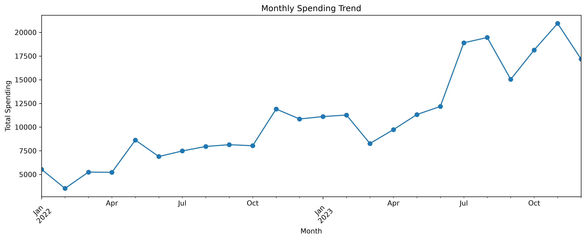
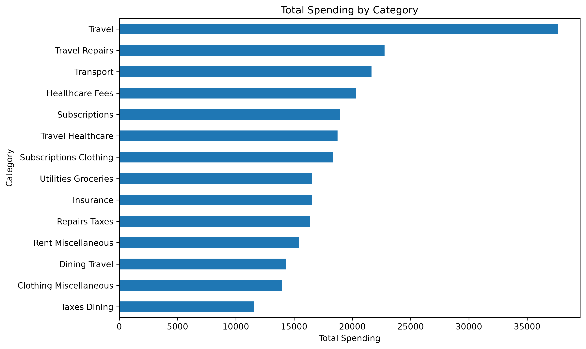
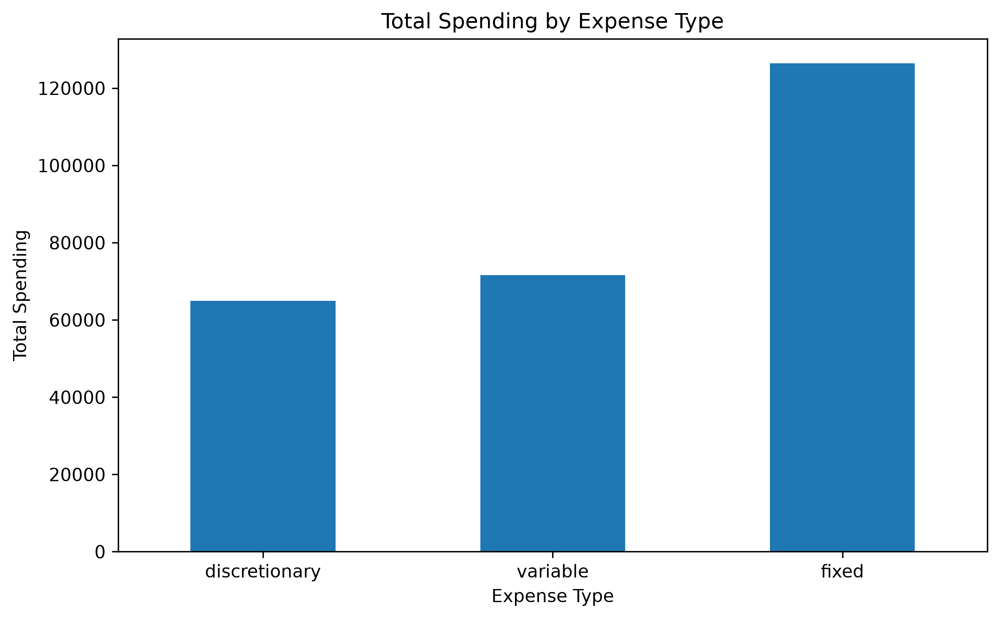
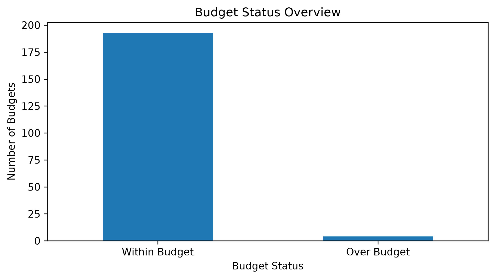

# 📊 Financial Data Analysis

A Python-based financial analytics project that explores transaction data, spending patterns, expense categories, and budget performance through data cleaning, exploratory data analysis (EDA), and visualization.

## 📌 Project Overview

Financial Data Analysis is a Python-based project focused on understanding transaction data, spending patterns, and budget performance.  
It uses Pandas and NumPy for data cleaning, preprocessing, and financial calculations.  
Exploratory Data Analysis (EDA) helps identify trends across expense categories and monthly spending.  
Matplotlib and Seaborn are used to create visualizations that highlight key financial insights.  
The project also evaluates budget performance by comparing budgeted amounts with observed spending.  
Overall, it transforms raw financial data into meaningful insights to support informed financial decision-making.

## 🎯 Project Objectives

- Clean and preprocess financial datasets.
- Analyze spending across categories and expense types.
- Identify monthly spending trends.
- Compare observed transaction spending against available budget records.
- Visualize financial patterns and trends.
- Generate meaningful insights to support better financial planning.

## 🛠️ Tools & Technologies

- **Python** — Core programming language
- **Pandas** — Data manipulation and analysis
- **NumPy** — Numerical operations
- **Matplotlib** — Data visualization
- **Seaborn** — Statistical visualization
- **Jupyter Notebook** — Interactive analysis and documentation

## 📁 Project Structure

```text
Financial-Data-Analysis/
├── Data/
│   ├── transactions.csv
│   ├── budgets.csv
│   └── categories.csv
├── Images/
│   ├── monthly_spending_trend.png
│   ├── spending_by_category.png
│   ├── expense_type_distribution.png
│   └── budget_status_overview.png
├── Reports/
│   ├── cleaned_transactions.csv
│   ├── cleaned_budgets.csv
│   ├── cleaned_categories.csv
│   └── Financial_Analysis_Report.md
├── Financial_Data_Analysis.ipynb
└── README.md
```

## 📈 Key Findings

| Metric | Result |
|---|---:|
| Total Transactions | 761 |
| Total Observed Spending | ₹262,983.73 |
| Average Transaction Amount | ₹345.58 |
| Highest-Spending Category | Travel |
| Highest-Spending Month | November 2023 |
| Lowest-Spending Month | February 2022 |
| Fixed Expenses | ₹126,457.04 |
| Variable Expenses | ₹71,590.54 |
| Discretionary Expenses | ₹64,936.15 |

### Key Insights

- **Spending Patterns:** Monthly analysis reveals variations in expenditure over time.
- **Category Analysis:** Travel recorded the highest spending by category name, totaling ₹37,667.01.
- **Expense Composition:** Fixed expenses accounted for approximately 48.1% of total observed spending.
- **Budget Evaluation:** The initial analysis identified four budget records as over budget and 193 as within budget, subject to the data limitations described below.

## 📊 Exploratory Data Analysis (EDA)

### 1. Monthly Spending Trend

This visualization illustrates changes in spending over time and helps identify months with higher or lower expenditure. November 2023 recorded the highest monthly spending, while February 2022 recorded the lowest.



### 2. Total Spending by Category

This chart compares expenditure across categories and helps identify the areas contributing most to overall spending. Travel recorded the highest spending by category name.



### 3. Total Spending by Expense Type

This visualization compares fixed, variable, and discretionary expenses. Fixed expenses represented approximately 48.1% of total observed spending.



### 4. Budget Status Overview

This chart summarizes the analyzed budget records by status, helping identify records classified as within budget or over budget.



## 💰 Budget Analysis

The initial analysis evaluated **197 valid budget records**:

- **193 records** were classified as within budget.
- **4 records** were classified as over budget.

**Data limitation:** Budget records with no matching transactions within their date ranges were assigned zero observed spending. Consequently, a budget classified as within budget does not necessarily indicate that actual expenses were zero or that the budget was fully adhered to. The results should be interpreted in light of this limitation.

The initial analysis also identified data-quality issues, including missing budget amounts and inconsistent budget date ranges. These issues require further investigation to improve the reliability of budget comparisons.

## ▶️ How to Run

### Prerequisites

Install Python and Jupyter Notebook.

### Installation

1. Clone or download this repository.
2. Open a terminal or command prompt in the project directory.
3. Install the required libraries:

   ```bash
   pip install pandas numpy matplotlib seaborn jupyter
   ```

4. Launch Jupyter Notebook:

   ```bash
   jupyter notebook
   ```

5. Open `Financial_Data_Analysis.ipynb`.
6. Run the notebook cells in order.

## 📑 Reports

The `Reports/` directory contains:

- **Cleaned Transactions:** Processed transaction data.
- **Cleaned Budgets:** Processed budget records.
- **Cleaned Categories:** Processed category information.
- **Financial Analysis Report:** A written summary of the analysis and findings.

## 🚀 Future Improvements

- Improve budget-to-transaction matching.
- Investigate inconsistent budget date ranges and missing budget amounts.
- Develop an interactive financial analytics dashboard.
- Introduce additional financial KPIs and spending indicators.
- Explore forecasting techniques to analyze potential future spending patterns.
- Improve budget evaluation to handle periods without matching transactions more accurately.

## ✅ Conclusion

This project demonstrates how Python can transform raw financial transaction data into meaningful insights. Through data cleaning, exploratory analysis, visualization, and budget evaluation, it highlights spending patterns, expense categories, and financial trends. The project also emphasizes the importance of data quality in achieving reliable results. Overall, it showcases practical data analytics skills and demonstrates how data-driven insights can support better financial planning and decision-making.

---

**Technologies:** Python | Pandas | NumPy | Matplotlib | Seaborn | Jupyter Notebook
